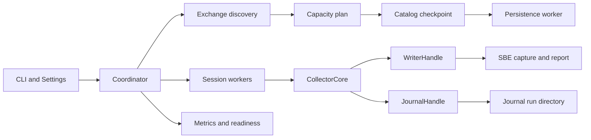
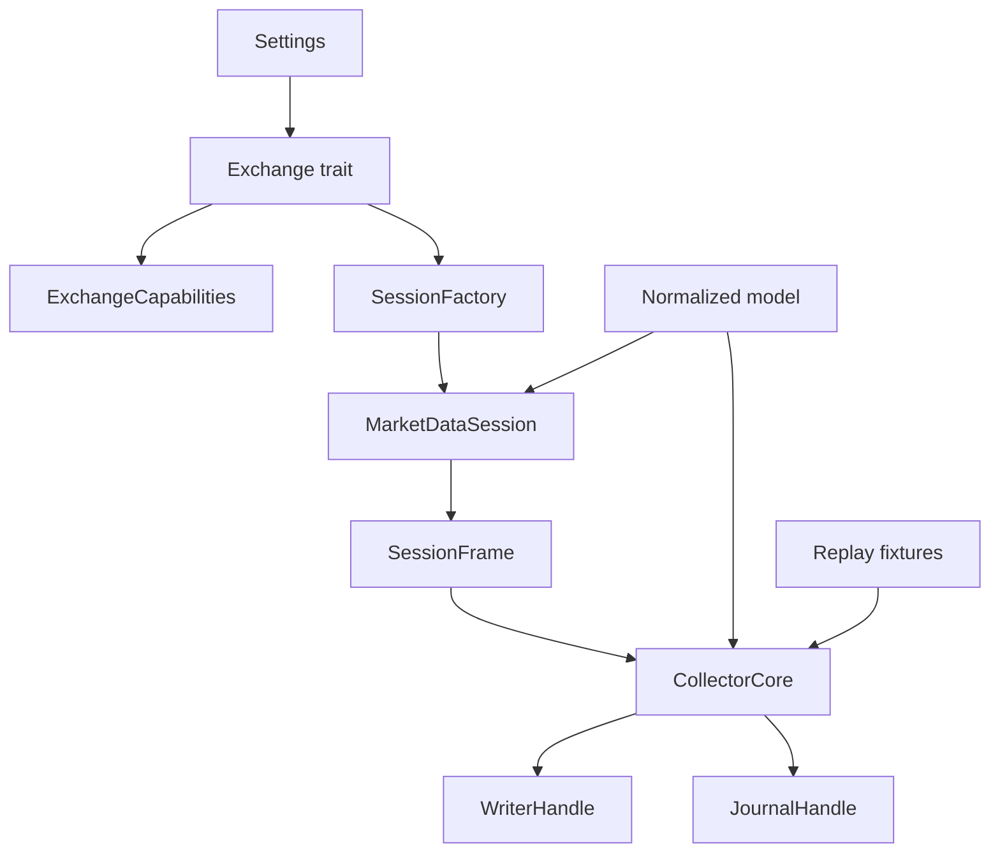
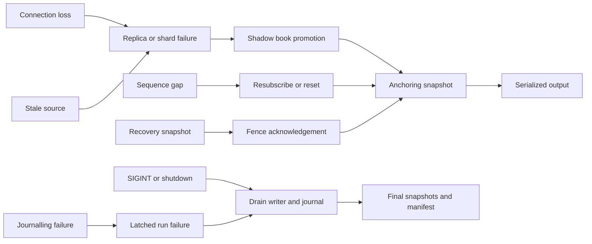

# Architecture

This document describes the implementation in `src/`, not the historical
archive audit or a target platform. The target domain and adapter boundaries
are in [`platform-charter.md`](platform-charter.md); this document does not
claim that the target capabilities exist. Gate results are in
[`programme-status.md`](programme-status.md); requirement evidence is in
[`docs/requirement-test-matrix.md`](requirement-test-matrix.md).

## Scope

The current system is a read-only prediction-market data collector. It discovers
markets, maintains one normalized order book per outcome symbol, writes the
supplied SBE schema, and optionally records exact public websocket frames. It
does not submit orders, hold positions, or run strategy or pre-trade risk.

Kalshi and Polymarket are the first venue adapters, not the limits of the
domain model. The general numeric model (PR #33) removed the universal
`[0, 1]` price range and six-decimal scale: `Price` and `Quantity` are exact
`i64` coefficients interpreted by each instrument's `NumericSpec` (scale,
units, tick bands, quantity step, lot size, contract multiplier), and the
prediction-market `[0, 1]` check now lives in the Kalshi/Polymarket adapters.
Remaining deliberate gaps — venue enumeration and binary outcome fields — are
listed in the [platform charter](platform-charter.md). Removing them is
scheduled work, not an implicit capability of this implementation.

## Runtime composition

`src/main.rs` parses the CLI and requires an explicit subcommand; no command
starts no provider activity. Before dispatching any provider-facing command it
loads the runtime rights file through `src/governance/rights.rs` and denies when
no live right covers the full requested identity and scope. Each command
declares the typed lifecycle operations it may require, and each egress
boundary passes the actual operation for a fresh check. A configurable,
writable audit sink is mandatory: the permitted decision is committed before a
client, socket or published file exists. Offline commands (replay,
inspect, verify, journal, analytics-verify) need no rights. Live collection
enters `src/distribution/coordinator.rs`, which constructs the exchange adapter, performs
discovery, plans capacity, loads a catalog, starts session workers (plus the
dedicated Kalshi lifecycle control plane), the writer, the journal, and the
metrics endpoint, and then runs one serialized event loop.

Discovery is venue-specific behind `Exchange`. `src/storage/capacity.rs` converts the
discovered records and outcome symbols into shard, connection, subscription,
memory, and snapshot-rate estimates before any worker starts. `src/storage/catalog.rs`
persists the last complete discovery round with a schema version, counts, and a
SHA-256 envelope; `src/storage/persistence.rs` writes metadata and catalog checkpoints
on a dedicated latest-wins thread.

Each session worker owns one websocket. It decodes frames, captures the receive
timestamp and optional raw payload, and emits normalized events. The
synchronous `CollectorCore` in `src/market_state/collector/state.rs` applies discovery,
snapshots, level changes, lifecycle events, stream resets, status, and ticks. It
chooses the active source per symbol and produces ordered output messages.
`src/storage/writer.rs` is the only SBE writer: one bounded queue and one thread
preserve total write order. `src/integrity/journal.rs` is a separate append-only path, so
the SBE schema is unchanged. `src/distribution/metrics.rs` serves counters, health, and
readiness without putting network work on the data path. Stage-specific latency
evidence lives in `src/market_state/histogram.rs`: one fixed-bucket histogram per boundary
is shared across workers, and a snapshot reports raw bucket counts plus
nearest-rank percentiles with explicit sample counts (never averaged worker
percentiles). Unexercised boundaries are reported as `unavailable` with a
reason, not zero.

`src/acquisition/egress.rs` binds how the process reaches the venue: direct networking by
default, or one explicitly configured proxy (`http` CONNECT or SOCKS5, with a
typed remote-DNS choice) resolved from environment variables at load time. A
failed proxy never falls back to direct egress; the failure is reported and
the connection is refused. REST discovery and websocket sessions build their
transport from the same policy. The non-secret route identity — mode, kind,
host, port, DNS mode, label and a SHA-256 fingerprint — is recorded in the
journal manifest and in `network-probe` reports; credentials never appear in
any of those artifacts. `src/distribution/probe.rs` implements `network-probe`, which
measures DNS, TCP, proxy negotiation, TLS and the websocket upgrade as
independent stages. It never authenticates to a venue; it classifies a
transport as `transport_ok` or `failed` with a deterministic reason and an
artifact the operator can check.

## Dedicated lifecycle control plane

Kalshi exposes `market_lifecycle_v2` as a separate channel. Subscribing to it
from every order-book shard duplicated the stream per replica and let an
unrelated control-plane failure take down a data-plane connection. Book
shards therefore carry only `orderbook_delta` subscriptions.

The coordinator starts `collector.lifecycle_replicas` supervised lifecycle
sockets (Kalshi only, default 1, maximum 4) alongside the book workers. Each
socket receives the same `market_lifecycle_v2` stream; the core deduplicates
notifications by `(market, kind, exchange timestamp, normalized-payload
fingerprint)` with a bounded window, so each distinct notification is applied
once however many lifecycle replicas are configured. A lifecycle event for an
untracked market is never applied blindly: Create/Activate events request an
out-of-cycle REST reconciliation (debounced, shared with the periodic ticker),
and terminal notifications for untracked markets are counted in
`lifecycle_unknown_symbols` rather than dropped. A `settled`/`determined`/`resolved`/`deactivated`
notification retires a tracked market exactly once and emits the normal
retirement boundary. Stale nonterminal backfills (exchange order older than
the applied high-water mark for the market) are dropped and counted; terminal
notifications are never dropped. A discovery round that started before an
applied terminal notification cannot resurrect the market, and cannot
overwrite lifecycle-applied metadata; a later round is authoritative again.

The lifecycle plane is separate from the book plane by design: it has no
order-book subscriptions, contributes nothing to the per-shard subscription
universe, is never counted as an active book source for continuity incidents,
and its sockets are included in the capacity plan's connection budget
(`capacity.lifecycle_connections`, bounded by `max_total_connections`). When
a lifecycle socket reconnects after a disconnect, the coordinator requests a
REST discovery round before the event stream is trusted again, because the
venue may have emitted notifications while the socket was down. Set
`lifecycle_replicas = 0` to disable the plane; new markets then enter only
via REST discovery and terminal removals are deferred to the reconciliation
cadence. Polymarket has no separate lifecycle channel; its `lifecycle_*`
notifications ride the market channel and are unaffected.

## Abstraction boundaries

`Exchange` reports venue capabilities and creates discovery and session
objects. `ExchangeCapabilities` currently carries `has_sequence_clock`; the core
consumes that value instead of identifying a venue by name. `SessionFactory`
creates a `MarketDataSession` for one source, and `src/acquisition/session.rs` supervises
reconnects, heartbeats, status, and control handling around it. Kalshi and
Polymarket implement these boundaries in `src/acquisition/exchange/{kalshi,polymarket}/`.
Hyperliquid implements them in `src/acquisition/exchange/hyperliquid/`: H0 reference data,
H1 telemetry, H2 selected perpetuals and H3 synthetic capacity evidence behind
the same seams, with no branch in the state machine. H2 reconciles an exact
finite book set, emits only full snapshots from `l2Book`, maps `trades` to
telemetry, and uses the existing `Control::{RequestSnapshot,Recover}` fences for
recovery; `has_sequence_clock` stays `false`. H3 adds a test-only loopback wire
mock that reuses the shared stress ledger, coverage hashes and manifest schema;
it produces no production behavior and no live or capacity claim. Kraken
implements H0 reference data in `src/acquisition/exchange/kraken/`: namespaced `AssetPairs`
decoding with exact scales and an active-only filter, offline-fixture and
read-only REST discovery, and a no-network session seam. H1-H3 remain planned;
no Kraken socket, book, telemetry or live evidence exists.
Binance implements H0 reference data in `src/acquisition/exchange/binance/`: deterministic
discovery of spot and perpetual instruments from an offline `exchangeInfo`-style
fixture, with explicit `binance:spot:<BASE>/<QUOTE>` /
`binance:perp:<SYMBOL>` identities, canonical-quote scoping and exact numeric
steps. Its session is a no-network stub with a disabled heartbeat and no
lifecycle plane; `has_sequence_clock` is `false`. H1-H3 are planned gates, not
implemented behavior, and no websocket, live, latency or capacity claim is made.

Ownership and dependency direction are deliberate:

adapters depend on the normalized model, not on the collector state machine;
`CollectorCore` depends on adapter capabilities and normalized events, not on
  a websocket library;
- the coordinator owns composition and lifecycle;
the writer owns the output file and the journal owns the journal directory;
the journal writes schema v2 and stores both application data frames and
  native transport controls as typed observations with independent
  `receive_seq`, `control_seq`, and `observation_seq` domains. ADR-0002 is
  implemented: controls never advance the application receive fence and are
  visible only through `read_observations()`, while `read_records()` stays
  data-only and v1 journals remain readable;
`replay` drives the same `CollectorCore` with fixture timestamps, so the
  deterministic path does not depend on the live coordinator.

## Failure model

A lost or failed source does not silently change history. For a sequenced
venue, a gap triggers a reset or resubscribe. For a clockless venue, failover
requires an acknowledged fence and a fresh snapshot; a recovery snapshot that
arrives before the acknowledgement is rejected without mutating the active
book. Shadow replicas are promoted only when their book is usable, and the
promotion is followed by an anchoring full snapshot. The same anchoring rule
applies to a stale source probe and to a sequence reset. Empty snapshots mark
retirement boundaries. `apply_discovery` adds and removes symbols without
mixing their histories.

Journal failures are terminal for the run: the failure latches across producers,
the writer, and finalization. Shutdown closes admission, drains accepted writer
and journal work, writes final snapshots, flushes and syncs when configured,
finalizes segments, writes the manifest, and then reports. A bounded deadline
prevents a blocked writer or journal thread from hanging shutdown indefinitely;
the run is reported as failed or incomplete instead of being called complete.

## Module responsibilities

| Area | Files | Responsibility |
|---|---|---|
| Composition | `main.rs`, `coordinator.rs`, `cli.rs`, `config.rs` | CLI, settings precedence, adapter construction, lifecycle |
| Universal data foundation | `taxonomy.rs`, `reference_data.rs`, `event_model.rs`, `adapter.rs`, `quality.rs`, `rights.rs`, `coverage_certification.rs`, `docs/specifications/` | Declarative V2 contracts for domains, identity, typed events, source capabilities, quality, rights and coverage certification; additive to the live collector |
| Discovery | `exchange/*/discovery.rs`, `capacity.rs`, `catalog.rs` | Venue discovery, eligibility, capacity admission, checkpoint |
| State | `collector/state.rs`, `orderbook.rs`, `model.rs`, `fixed.rs` | Serialized books, failover, fixed-point values, output model |
| Data-product contracts | `products.rs`, `exchange/mod.rs` (`source_capabilities_for`) | Platform M3 Phase 1 typed products, stable subscription keys from legacy native symbols, typed source capabilities, and an explicit subscription state machine with connection epochs; declarations only, no session-API, SBE, journal, replay or catalog change. H0-only venues declare reference data and no live products. |
| Canonical event model | `canonical.rs`, `docs/canonical-event-model.md` | Platform M4 Phase 1 typed canonical envelope and taxonomy with deterministic opaque event ids, explicit provenance, schema-versioned serialization and a fail-closed reader; exact `ExchangeEvent` mappings only (no fabricated trades, BBO, assets or gaps). `NormalizedStore` is a contract with a test-only in-memory implementation; the raw journal is independent, the SBE writer is one projection, and no durable store, connector, performance or live claim is made. |
| Non-market-data reference app | `application.rs`, `application/postgres.rs`, `docs/jsonl-postgres-reference.md` | Platform P5 second application proving source/target independence: JSONL source -> typed `CanonicalBusinessEvent` -> idempotent target contract with receipts, obligations and checkpointed resume; parameterized PostgreSQL SQL, a deterministic in-memory simulator and an opt-in real `PgTarget` with explicit migrations and database-enforced idempotency. No market-data module, SBE/journal/replay/catalog change, replication or performance claim; the live test needs an operator-supplied server. |
| Durable reference pipeline | `application/file_source.rs`, `application/network_source.rs`, `application/durable.rs`, `application/postgres.rs`, `docs/durability-contract.md`, `tests/durable_pipeline.rs`, `tests/network_source.rs`, `tests/postgres_live.rs` | Platform P6 adds a fixed-buffer `BufRead` line source with exact bytes, physical offsets, a registered identity and a one-shot SHA-256 content fingerprint (64 KiB hash buffer; exact duplicate detection uses a fixed-size bucket table with a disk-backed index, not an O(unique) in-memory map); a verified resume anchor bound to (source id, fingerprint, target id); and a real local append-only, checksummed, fsync-capable commit store whose single record carries ids, dispositions/quarantines and the new checkpoint. Reopen verifies checksums and sequence gaps. Delivery receipts are six categories with `ExecutionMode`; simulated modes never write externally or move the durable checkpoint; rejection quarantines durably before progression. PostgreSQL has a synchronous driver, explicit migrations, source-scoped checkpoints and idempotency, and an opt-in live `PgTarget`; the network source is loopback-only. No replication, production network certification or performance claim. |
| Acquisition plane (V2) | `acquisition/{mod,transport,codec,arbiter,packet,supervisor}.rs` | Additive TCP/UDP/multicast transport, codec registry, dual-channel sequence arbitration, raw packet evidence and bounded connection supervision; no new dependency and no change to the live collector path |
| Transport | `exchange/*/session.rs`, `session.rs`, `ws.rs`, `egress.rs`, `protocol.rs` | Protocol handling, supervised workers, connection options, shared typed frame/signal vocabulary; egress policy: direct or explicit fail-closed proxy, route provenance. Hyperliquid's session subscribes to H1 telemetry (`allMids`/`fastAssetCtxs`) plus H2 `l2Book`/`trades` for the exact selected perpetuals; `request_snapshot` resubscribes/wait-for-next-push and `Recover` fences by the existing receive epoch/sequence. |
| Adapter telemetry | `exchange/hyperliquid/telemetry.rs` | H1 exact-decimal decoding of venue-wide `allMids`/`fastAssetCtxs` statistics into typed `ProtocolControl` observations; `fastAssetCtxs` base64 + raw DEFLATE JSON map decoded from the real venue wire shape, finer-than-SBE values retained verbatim without rounding, malformed values rejected; no depth, `Snapshot`, `LevelChange` or heartbeat acknowledgement |
| Adapter books | `exchange/hyperliquid/books.rs` | H2 exact-decimal decoding of full two-sided `l2Book` pushes into `ExchangeEvent::Snapshot` with exact receive time and advisory feed timestamp; `trades` stay `ProtocolControl` telemetry; identity is `hyperliquid:perp:<dex>:<coin>`; no spot books, no `LevelChange`, no full universe |
| Adapter reference (Kraken) | `exchange/kraken/{mod,codec,discovery,session}.rs` | H0 namespaced `kraken:spot:BASE/QUOTE` identity from `wsname` or normalized legacy base/quote; exact `tick_size`/`lot_decimals` scales with precision rejection; `status == "online"` active filter; offline-fixture and read-only REST `AssetPairs` discovery; H0 no-network session with disabled heartbeat. H1-H3 planned, no live claim. |
| Adapter reference (Binance H0) | `exchange/binance/{mod,codec,discovery,session}.rs` | Offline `exchangeInfo` decoding into validated `MarketInfo` with explicit `binance:spot:<BASE>/<QUOTE>` / `binance:perp:<SYMBOL>` identity, canonical-quote filter and exact steps from `PRICE_FILTER`/`LOT_SIZE`; precision beyond scale 6 rejected, never rounded; no-network session stub, disabled heartbeat, no lifecycle plane; H1-H3 planned only |
| Stress lab (test-only) | `tests/stress_support/{mock,hyperliquid,runner,manifest}.rs`, `tests/full_universe_stress.rs`, `tests/hyperliquid_capacity.rs` | Deterministic loopback venues (Kalshi, Hyperliquid) and a shared fail-closed cell runner. The Hyperliquid H3 mock serves `meta` discovery, WS subscribe/unsubscribe, `allMids`, `fastAssetCtxs`, `l2Book`, trades and a scripted reconnect from a seed-derived explicit schedule; three profiles drive mid fan-out, fast-context rate, book refresh cadence and trade bursts. The cell reuses the event ledger, dispositions, three-set coverage hashes and v16 manifest schema. Evidence is synthetic loopback: not live certification and no latency/capacity claim. |
| Control plane | `exchange/kalshi/session.rs` (`SessionMode::Lifecycle`), `coordinator.rs`, `collector/state.rs` | Dedicated Kalshi `market_lifecycle_v2` subscription, cross-connection dedup, reconciliation triggers |
| Diagnostics | `probe.rs` | `network-probe`: stage-timed transport diagnostic, JSON report |
| Output | `writer.rs`, `util/aligned_sbe_*.rs`, `util/dtos.rs` | Ordered SBE writes, chunk framing, supplied-schema DTOs |
| Durability | `journal.rs`, `persistence.rs`, `report.rs` | Raw-frame journal, checkpoints, run sidecars |
| Offline tools | `replay.rs`, `inspect.rs`, `verify.rs`, `latency.rs`, `completeness.rs`, `coverage.rs` | Deterministic replay, decode, consistency, latency, per-symbol completeness accounting, and per-symbol live-coverage certification |
| Operations | `metrics.rs`, `time.rs` | Counters, health/readiness, receive-time helpers |

## Current operational caveat

Readiness is a local admission signal, not a venue certification. `/readyz`
reflects discovery, catalog, persistence, writer, and journal state; it cannot
prove that a live venue delivered every update. The collector is a market-data
component and is **not a production certification** for order entry, execution,
or trading. Order management, execution, portfolio management, and risk remain
separate bounded contexts under the [platform charter](platform-charter.md).
The second, non-market-data reference application is described in
[`docs/jsonl-postgres-reference.md`](jsonl-postgres-reference.md): its target
is a deterministic simulator plus a parameterized SQL contract, not a live
database, and it makes no performance or live claim.
See [`operating-envelope.md`](operating-envelope.md) for measured
limits and [`design-decisions.md`](design-decisions.md) for the rationale.
Implementation contracts are in [`replay-format.md`](replay-format.md),
[`raw-frame-journal.md`](raw-frame-journal.md), and [`latency.md`](latency.md).
